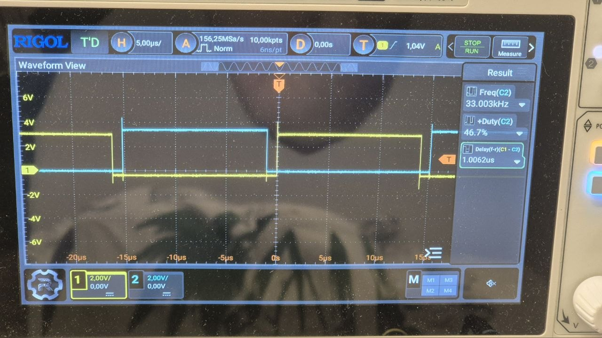
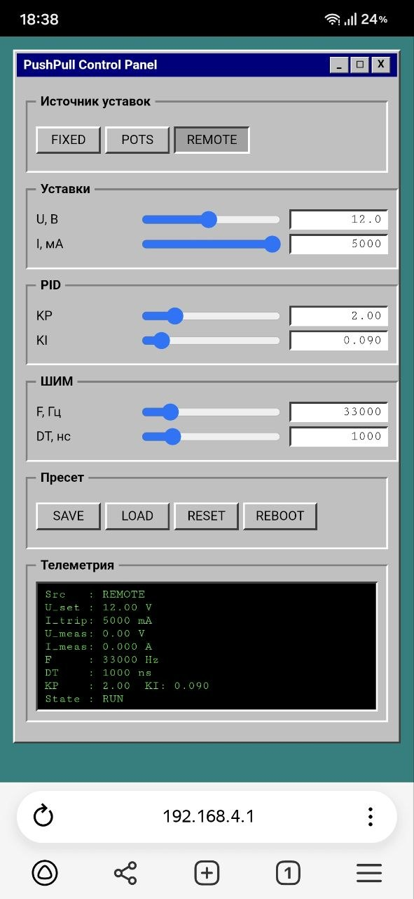

# PushPullCore

Push-pull MCPWM controller for ESP32 with PID, ADC, NVS preset.





## Возможности

- **MCPWM push-pull** с программным dead-time (100 нс … 5 мкс)
- **Частота ШИМ** 20 … 100 кГц (меняется на лету)
- **PID-регулятор** напряжения с anti-windup
- **ADC**: измерение напряжения и тока, калибровка
- **Аппаратная защита** (nFAULT) + программная по току
- **Soft-start** (2000 мс)
- **Три источника уставок**: FIXED / POTS / REMOTE
- **NVS-пресет** (U, I, KP, KI, F, DT, source)
- **Serial** интерфейс — команды `U= I= KP= KI= F= DT= SRC= SAVE LOAD RESET STATUS`
- **Кнопка SAVE/RESET** + LED
- **Web-интерфейс** в стиле Windows 95 (Wi-Fi AP)

## Установка

### PlatformIO

```ini
lib_deps =
    andreigrodno/PushPullCore@^1.0.0
